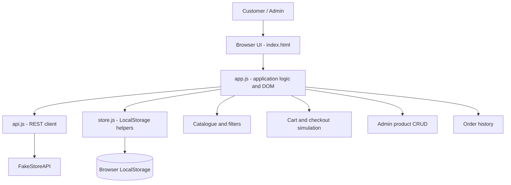

# ShopSmart Architecture

## Data flow

1. `app.js` calls `fetchProducts()` during initialization.
2. `api.js` checks the time-limited LocalStorage cache before calling FakeStoreAPI with `fetch` and `async/await`.
3. The application renders product data and derives filtered/sorted results from the current UI state.
4. `store.js` centralizes persistence for the cart, demo users, session, orders and locally managed products.
5. The admin workspace changes only locally managed product data. It does not write to FakeStoreAPI.
