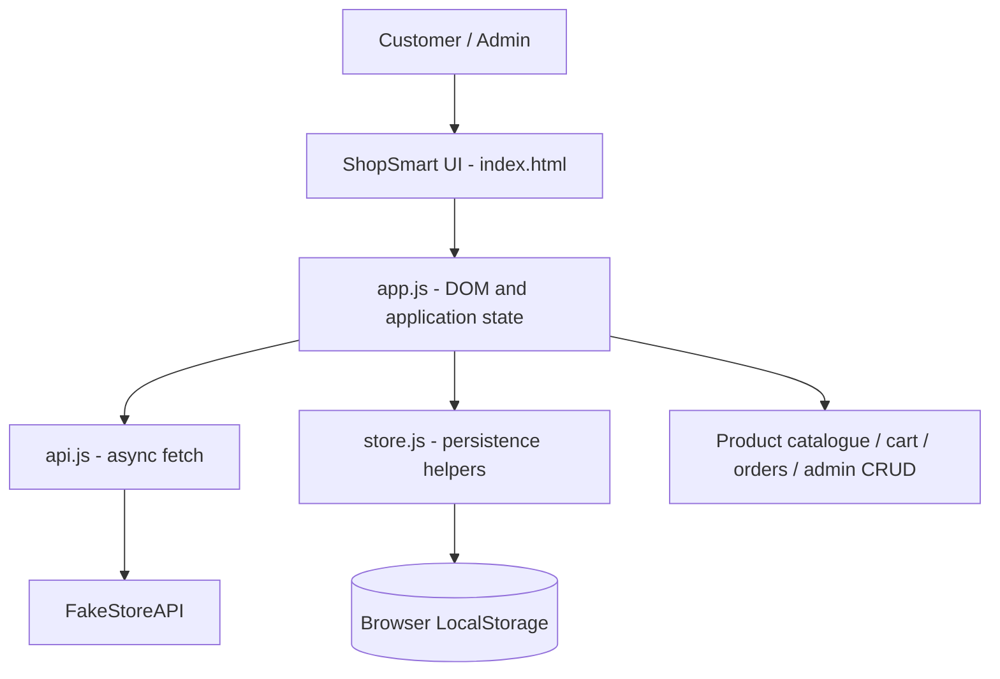

# ShopSmart — E-Commerce Storefront Capstone

A responsive, front-end e-commerce demonstration built with HTML5, CSS3 and vanilla JavaScript ES modules. It combines a live product catalogue with a simulated customer account, shopping cart, demo checkout, order history and an admin workspace with product CRUD.

> **Educational demo notice:** Authentication and checkout are simulations. Account details and app state are stored in the browser's LocalStorage. Do not use real passwords, payment information or personal data. This is not a production-secure commerce system and has no payment processor or server-side database.

## Features

### Customer storefront
- Responsive home page with category shortcuts and featured products.
- Product catalogue fetched asynchronously from [FakeStoreAPI](https://fakestoreapi.com/).
- Product search, category filtering and sorting by name, price and rating.
- Add products to cart, change quantities and remove items.
- Cart and product API cache persist in LocalStorage.
- Simulated checkout with delivery details and order confirmation.
- Customer registration/sign-in simulation and order history.

### Admin workspace
- Demo admin sign-in.
- Create, view, update and delete locally managed products.
- Product list and order count summary.
- Custom catalogue changes persist in LocalStorage.
- API-sourced products are read-only in the external service; editing an API item creates a local override, and deleting is enabled only for locally created products.

### Reliability and accessibility
- API response validation and user-friendly fallback message.
- Previously cached products are shown when the API is unavailable.
- Semantic landmarks, form labels, skip link, keyboard-operable buttons and live status messages.
- Responsive layout for desktop, tablet and mobile.

## Technology stack

| Technology | Use |
|---|---|
| HTML5 | Semantic page structure and forms |
| CSS3 | Responsive layout and visual design |
| JavaScript ES6+ | Modules, async/await, DOM events and rendering |
| FakeStoreAPI | External product data |
| LocalStorage | Demo accounts, cart, orders, custom products and API cache |
| Git/GitHub | Version control and source hosting |
| Netlify | Suggested static hosting platform |

## Project structure

```text
Task-06-Ecommerce-Capstone/
├── index.html
├── css/
│   └── styles.css
├── js/
│   ├── api.js       # REST API fetch and cache
│   ├── app.js       # UI, authentication simulation, cart, CRUD and checkout
│   └── store.js     # LocalStorage read/write helpers
├── assets/          # Optional local images and assets
├── README.md
└── .gitignore
```

## Architecture



## Run locally

No build tools or package installation are required. Use a local HTTP server because the app uses JavaScript ES modules.

### Option 1: Python

```bash
python -m http.server 8080
```

Open <http://localhost:8080> in your browser.

### Option 2: VS Code Live Server

Open this folder in VS Code, install/enable the Live Server extension if needed, right-click `index.html`, and choose **Open with Live Server**.

Internet access is needed to fetch the initial product list. Once products have been cached, the app can display the cached catalogue if the API is temporarily unavailable.

## Demo admin account

- Email: `admin@shopsmart.demo`
- Password: `admin123`

Customers can create a demo account through the Sign in dialog. These credentials are stored locally in the current browser only.

## Test checklist

- [ ] Home, shop, cart, orders and admin navigation
- [ ] Product API loads and product cards appear
- [ ] Search, category filters and sorting
- [ ] Add to cart, increase/decrease quantity and remove
- [ ] Cart persists after page refresh
- [ ] Customer registration, sign-in and sign-out
- [ ] Demo checkout creates an order in order history
- [ ] Admin can add, edit and delete a locally created product
- [ ] Custom products and orders persist after refresh
- [ ] Mobile layout and keyboard navigation

## Deploy to Netlify

1. Push this project folder to a new GitHub repository.
2. Sign in to Netlify and choose **Add new site → Import an existing project**.
3. Connect GitHub and select the capstone repository.
4. For this static project, leave the build command empty and set the publish directory to `.` (the repository root).
5. Select **Deploy site** and wait for the deployment to finish.
6. Open the generated public URL and test the main flows again.

You can also use Netlify's manual deploy by dragging the project folder (containing `index.html`) into the deploy area. A Git-connected deployment is recommended for future updates.

## Limitations and production improvements

This capstone is a client-side demonstration. A real commerce product would require a secure backend, hashed passwords, server-side authorization, database-backed inventory and orders, input validation on the server, HTTPS, and a compliant payment provider. LocalStorage must not be used for sensitive authentication or payment data.
